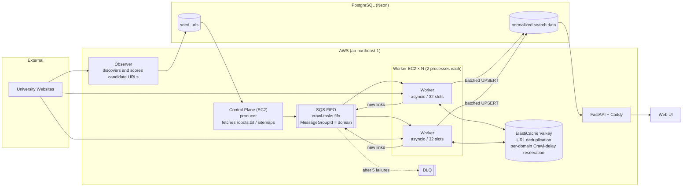

# University Comparison Site

[日本語](README.md) | English

A data collection and search system that gathers degree programs from overseas universities and lets users search them by degree level, country, online availability, tuition, and more.

Because every university uses a different page structure and tuition notation, the system is split into a pipeline of collection, transformation, normalization, and search. The crawler was rebuilt from a single-machine design (Legacy) into a **distributed design across multiple EC2 instances using SQS and Valkey**, and the improvement was verified with benchmarks against a mock server.

> Detailed documents linked from this README (runbooks, benchmark design notes) are written in Japanese.

## Contents

1. [Overview](#1-overview)
2. [Architecture](#2-architecture)
3. [Benchmark Results](#3-benchmark-results)
4. [Features](#4-features)
5. [Tech Stack](#5-tech-stack)
6. [Design Decisions](#6-design-decisions)
7. [Getting Started](#7-getting-started)
8. [Terraform / AWS](#8-terraform--aws)
9. [Known Issues and Next Steps](#9-known-issues-and-next-steps)
10. [Repository Layout and Documents](#10-repository-layout-and-documents)

## 1. Overview

### Background and Goals

The goal is to make degree program information, which is scattered across official university websites, comparable in one place. Since each site differs in HTML structure, URL conventions, and tuition units, the following steps are automated:

- Discovering candidate URLs on university and education sites (Observer)
- Crawling that respects robots.txt (including Crawl-delay) and sitemaps
- Extracting degree programs and tuition information
- Normalizing tuition notations such as annual and monthly fees
- Storing data in PostgreSQL with deduplication
- Searching by conditions and showing details through an API

### Target Users

- Students and working professionals who want to compare degree programs at overseas universities
- Users who want to narrow down universities and courses by conditions

## 2. Architecture

### Distributed Crawler (current)



| Component | Role |
| --- | --- |
| Observer | Observes information sources and registers URLs that pass the quality gate into `seed_urls` |
| Control Plane (producer) | Reads `seed_urls`, fetches each domain's robots.txt and sitemap, and enqueues tasks into SQS. Runs once and exits |
| SQS FIFO | Distributes tasks to workers. `MessageGroupId` is set to the domain so that tasks for the same domain are never handed to multiple workers at once. Tasks that fail 5 times move to the DLQ |
| Worker | Receives tasks from SQS, fetches and extracts pages, and sends newly found links back to SQS. Extracted records are written to the DB in batches by count and by time |
| Valkey | Deduplicates processed URLs and reserves the "next allowed access time" per domain (enforcing Crawl-delay across workers) |
| FastAPI + Caddy | Search API connected to the DB with a read-only role. Caddy serves it over HTTPS |

### Legacy (single-machine design)

Runs Scheduler → Crawler → `asyncio.Queue` → JSONL Writer → Transform / Load in a single process. Extracted records are written to `log/extracted_records_*.jsonl` and then loaded into the DB by the ETL. It served as the baseline in the benchmarks ([`ControlPlane/ETL.py`](ControlPlane/ETL.py)).

## 3. Benchmark Results

To benchmark without putting load on real university sites, I built a **mock server that impersonates 1,000 fictitious domains (`dNNNN.bench.internal`) on a single instance**, and redirected the crawlers to it (HTTPS included) with a Route 53 private hosted zone and a private CA. All figures are computed from the mock server's access logs.

### Test A: Throughput as the number of workers grows (31,000 pages)

Workers are t3.micro instances, each running 2 processes with 32 concurrent slots per process.

| Configuration | Processes | Total time | URLs/sec | Crawl phase only | Steady state | vs Legacy | Crawl-delay violations |
| --- | ---: | ---: | ---: | ---: | ---: | ---: | ---: |
| Legacy (1 instance) | 1 | 1460.4 s | 21.22 | 21.63 | - | 1.00x | 24 |
| Distributed x1 | 2 | 997.6 s | 31.08 | 33.72 | ~34.5 | 1.46x | **0** |
| Distributed x2 | 4 | 533.5 s | 58.11 | 65.01 | ~71 | 2.74x | **0** |
| Distributed x3 | 6 | 462.1 s | 67.08 | 82.49 | ~101 | 3.16x | **0** |
| Distributed x4 | 8 | 401.7 s | 77.17 | 97.08 | ~130 | **3.64x** | **0** |

- The distributed crawler fetched 31,000/31,000 pages in every run with zero Crawl-delay violations
- Steady-state throughput scaled almost linearly with the number of workers (2.05 / 2.93 / 3.77x relative to x1, 94% efficiency even at x4). SQS, the DB, and the mock server were not bottlenecks even at x4
- Total-time throughput grows more slowly because of fixed costs that do not shrink with more workers (about 80 s of producer preparation and about 60 s waiting on Crawl-delay for the last domains)

### Test C: The limit of a single process

With one worker and one process, raising the concurrency from 16 → 32 → 64 slots gave 14.4 → 20.0 → 19.1 URLs/sec, **plateauing at about 20 URLs/sec with 32 slots**. Overall EC2 CPU usage was only about 30%, showing that the limit is a single Python process (one event loop), not the instance. Based on this, Test A runs 2 processes per instance.

### Details (Japanese)

- Full comparison table: [`docs/benchmark/A-compare.md`](docs/benchmark/A-compare.md)
- Per-run reports: [`benchmark/results/<run name>/report.md`](benchmark/results/)
- Benchmark design and issues found and fixed along the way (R1–R12): [`benchmark/benchmark_concept_revisions.md`](benchmark/benchmark_concept_revisions.md)
- AWS setup used for benchmarking: [`benchmark/benchmark_environment.md`](benchmark/benchmark_environment.md)

## 4. Features

### Collection and Crawling

- `httpx` by default, with a `requests` fallback when needed
- Candidate URL generation that respects robots.txt and sitemaps
- Crawling scoped to the same domain and target paths
- Recording reasons for failed fetches such as Cloudflare, JavaScript-dependent pages, and empty pages
- Extraction of university names, degree programs, course types, online availability, and tuition

### ETL and Data Quality

- Transformation into `universities`, `degree_programs`, `tuition_patterns`, and mapping tables
- Stores a normalized monthly amount for comparison while keeping the original amount and currency
- Quality gate on observation logs (seed discovery rate, fatal error rate, average API calls, fatal errors on PDF fetches)

### Search API and UI

- Filtering by keyword, country, degree level, category, online availability, and tuition type, currency, and price range
- Sorting by last verified date, amount, and normalized monthly amount
- Pagination with optional total counts
- Program details and tuition history
- Health check at `/health`

## 5. Tech Stack

| Area | Technologies |
| --- | --- |
| Language | Python 3.11 |
| Crawler | asyncio, httpx, requests, BeautifulSoup |
| Distributed processing | AWS SQS (FIFO + DLQ), ElastiCache Serverless (Valkey), boto3 |
| Database | PostgreSQL (Neon), psycopg2 |
| API | FastAPI, Uvicorn, Caddy (HTTPS) |
| Frontend | HTML / CSS / JavaScript (`webpage/`) |
| Containers | Docker, Docker Compose |
| Infrastructure | AWS EC2, Route 53, IAM, Terraform |
| Benchmarking | Custom mock server (reproduces 1,000 domains from a scenario YAML), custom analysis and reporting tools |
| Testing | pytest, quality gate scripts |

## 6. Design Decisions

### Keep order within a domain, parallelize across domains

The SQS FIFO `MessageGroupId` is set to the domain. Tasks for the same domain are processed one at a time, which makes Crawl-delay easy to honor, while different domains are processed in parallel by multiple workers. Within a single process, each worker also handles multiple domains concurrently with `asyncio`.

### Enforce Crawl-delay across workers

Each domain's "next allowed access time" is stored in Valkey, and a slot is reserved with a Lua script right before each fetch. Because the reservation is a single atomic operation, slots never overlap even when multiple workers reserve at the same time. The Valkey server's clock is used, so clock skew between instances has no effect. The interval is counted from the completion of the previous access, so slow responses never shorten it. In the benchmarks, the distributed crawler had zero violations in every run.

### Measure on the server side

Throughput, missed pages, and Crawl-delay violations are computed from the access log received by the mock server, not from the crawler's own records. This lets Legacy and the distributed crawler be compared on the same basis, and crawler-side bugs cannot distort the results.

### Separate collection from serving

The crawler and the search API are separate, and the search API connects to the DB with a read-only role. Slow crawls barely affect API response times, and the API cannot accidentally modify data.

### Keep failures as data

HTTP errors, timeouts, bot protection, sitemap fetch failures, and so on are not discarded but stored in logs and observation tables, and used for selecting future targets and for quality gate decisions.

### Separate configuration from code

DB credentials live in `.env` and environment-specific AWS values in `terraform.tfvars`, both excluded from Git. The public [`terraform.tfvars.example`](terraform/terraform.tfvars.example) contains placeholders only.

## 7. Getting Started

### Requirements

- Python 3.11 or later
- Docker / Docker Compose
- A PostgreSQL database
- For the distributed crawler: an SQS queue and Valkey (created with [Terraform](#8-terraform--aws))

### Environment Variables

Create `.env` with the connection settings required for the process you run. Do not commit real passwords or DSNs.

### Distributed Crawler (Docker Compose)

```bash
# On the Control Plane instance (enqueues tasks and exits)
docker compose --profile distributed run --rm controlplane

# On each worker instance (2 processes per instance)
docker compose --profile distributed up -d --build --scale worker=2 worker
```

Worker concurrency is set with `WORKER_MAX_CONCURRENCY` (32 in the benchmarks).

### Legacy, API, and Observer (Python)

```powershell
python -m venv .venv
.\.venv\Scripts\Activate.ps1
pip install -r requirements.txt

uvicorn search.searcher:app --reload --port 8000   # API
python -m ControlPlane.ETL                         # Legacy ETL (crawl -> JSONL -> DB load)
python -m ControlPlane.ETL --skip-crawl            # transform and load only, using the previous JSONL
python -m observer.observer                        # Observer
```

### Serving the API over HTTPS (EC2 + Caddy)

```bash
# Set the public domain in .env, e.g. DOMAIN=degrees.example.com
docker compose up --build -d api caddy
docker compose logs --follow caddy
```

Point the domain's A record at an Elastic IP and Caddy obtains a certificate automatically. The API is published only on the loopback address and is reached from outside through Caddy's HTTPS endpoint. Certificates are stored in the `caddy_data` volume, so do not run `docker compose down -v`.

## 8. Terraform / AWS

The configuration is in [`terraform/`](terraform/).

| File | Manages |
| --- | --- |
| `main.tf` | Control Plane and worker EC2 instances (count set by `worker_count`), security groups |
| `sqs.tf` | `crawl-tasks.fifo`, its DLQ, and the IAM role for workers |
| `valkey.tf` | ElastiCache Serverless (Valkey) |
| `benchmark.tf` | Benchmark-only mock server, Legacy instance, and Route 53 private zone (created and removed with `benchmark_enabled`) |

The VPC and subnets are existing resources referenced by ID.

```bash
cd terraform
terraform init
terraform plan
terraform apply
```

Because the benchmark resources live in the same configuration as production, they are removed by switching variables and running `apply`, not with `terraform destroy`. `terraform.tfstate` contains AWS resource information and is not committed.

## 9. Known Issues and Next Steps

- **Reduce fixed costs**: producer preparation (fetching robots.txt and sitemaps and enqueuing) takes about 80 s and does not shrink with more workers. Moving it to workers or parallelizing it is under consideration
- **Per-process performance**: SQS delete/send calls (synchronous boto3) and HTML parsing block the event loop. Moving them to threads or separate processes is under consideration
- **Crashes before a batch write**: SQS messages are deleted right after processing, so records not yet written to the DB are lost if a worker crashes
- **Automate worker setup**: the application is currently deployed by hand after an instance starts. Automate it with user_data and Secrets Manager
- **More Observer sources**: add sources by country and region, targeting real university sites
- **Public search API**: review authentication, rate limiting, and allowed CORS origins for production
- **Update CI/CD**: still set up for the old Railway deployment and needs updating for the distributed crawler

## 10. Repository Layout and Documents

```text
ControlPlane/   producer (enqueuing tasks), scheduler, Legacy ETL, resource recording
crawler/        shared fetching and extraction logic
  distributed/  distributed worker (SQS, Valkey deduplication and Crawl-delay reservation, DB writes)
observer/       observing sources, scoring candidate seeds
db/             schemas, transformation, DB persistence
search/         FastAPI search API
webpage/        search and detail pages
terraform/      IaC for AWS (EC2, SQS, Valkey, benchmark resources)
benchmark/      mock server, scenarios, analysis and reporting tools, runbooks, results
tests/          tests
docs/           benchmark comparison tables, schema notes, archived READMEs
```

| Document (Japanese) | Contents |
| --- | --- |
| [`benchmark/benchmark_concept.md`](benchmark/benchmark_concept.md) | Original benchmark design |
| [`benchmark/benchmark_concept_revisions.md`](benchmark/benchmark_concept_revisions.md) | Design revisions and results of each test (R1–R12) |
| [`benchmark/benchmark_environment.md`](benchmark/benchmark_environment.md) | AWS setup used for benchmarking |
| [`benchmark/runbook_A.md`](benchmark/runbook_A.md) | Runbook for Test A ([Test B](benchmark/runbook_smoke_B.md), [Legacy](benchmark/runbook_legacy_B.md)) |
| [`benchmark/mock/README.md`](benchmark/mock/README.md) | Mock server and scenario files |
| [`benchmark/analysis/README.md`](benchmark/analysis/README.md) | Analysis and reporting tools |
| [`docs/queue_log_schema.md`](docs/queue_log_schema.md) | Queue log schema |
| [`docs/archive/original_md/`](docs/archive/original_md/) | Original Markdown files before reorganization (as of 2026-10-25) |
