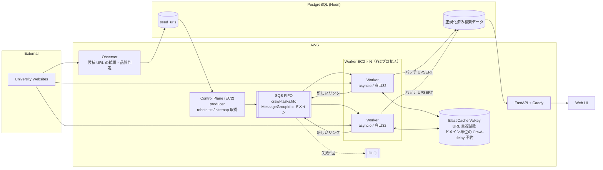

# University Comparison Site

日本語 | [English](README.en.md)

海外大学の学位プログラムを収集し、学位レベル・国・オンライン対応・授業料などの条件で検索できるデータ収集・検索システムです。

大学ごとに異なるページ構造と授業料表記を、収集・変換・正規化・検索のパイプラインとして分離しています。クローラーは1台で処理する方式（Legacy）から、**SQS と Valkey を使って複数の EC2 で分散する方式**に作り替え、Mock Server を使った計測で効果を確認しました。

## 目次

1. [プロジェクト概要](#1-プロジェクト概要)
2. [アーキテクチャ](#2-アーキテクチャ)
3. [性能計測の結果](#3-性能計測の結果)
4. [主要機能](#4-主要機能)
5. [技術スタック](#5-技術スタック)
6. [設計上のポイント](#6-設計上のポイント)
7. [実行方法](#7-実行方法)
8. [Terraform / AWS](#8-terraform--aws)
9. [現在の課題・今後](#9-現在の課題今後)
10. [リポジトリ構成・ドキュメント](#10-リポジトリ構成ドキュメント)

## 1. プロジェクト概要

### 背景と目的

大学の公式サイトに分散している学位プログラム情報を、横断的に比較できるようにすることが目的です。対象サイトごとに HTML 構造、URL 規則、授業料の単位が異なるため、次の処理を自動化しています。

- 大学・教育機関サイトからの候補 URL の発見（Observer）
- robots.txt（Crawl-delay を含む）と sitemap を考慮したクロール
- 学位プログラムと授業料情報の抽出
- 年額・月額などの授業料表記の正規化
- PostgreSQL への重複を抑えた格納
- API 経由での条件検索と詳細表示

### 対象ユーザー

- 海外大学の学位プログラムを比較したい学生・社会人
- 大学やコースの候補を条件で絞り込みたい利用者

## 2. アーキテクチャ

### 分散クロール（現行）



| 構成要素 | 役割 |
| --- | --- |
| Observer | 情報源を観測し、品質ゲートを通った URL を `seed_urls` に登録する |
| Control Plane（producer） | `seed_urls` を読み、各ドメインの robots.txt・sitemap を取得して SQS にタスクを投入する。1回実行して終わる |
| SQS (FIFO) | タスクを Worker に配る。`MessageGroupId` をドメインにして、同じドメインのタスクが同時に複数の Worker へ渡らないようにする。5回失敗したタスクは DLQ へ移す |
| Worker | SQS からタスクを受け取ってページを取得・抽出し、見つけたリンクを SQS に戻す。抽出結果は一定件数・一定時間ごとに DB へまとめて書き込む |
| Valkey | 処理済み URL の重複排除と、ドメインごとの「次にアクセスしてよい時刻」の予約（Worker をまたいで Crawl-delay を守る） |
| FastAPI + Caddy | 読み取り専用ロールで DB に接続する検索 API。Caddy が HTTPS で公開する |

### Legacy（1台で処理する旧方式）

Scheduler → Crawler → `asyncio.Queue` → JSONL Writer → Transform / Load を1つのプロセスで実行する。抽出結果を `log/extracted_records_*.jsonl` に書き出し、ETL が DB に投入する。性能計測では比較の基準として使用（[`ControlPlane/ETL.py`](ControlPlane/ETL.py)）。

## 3. 性能計測の結果

本物の大学サイトに負荷をかけずに計測するため、**1,000 個の架空ドメイン（`dNNNN.bench.internal`）を1台で再現する Mock Server** を作り、Route 53 のプライベートゾーンと独自の CA で HTTPS ごと置き換えて計測した。数値はすべて Mock 側のアクセスログから計算している。

### 試験A：台数を増やしたときのスループット（31,000 ページ）

Worker は t3.micro、1台あたり2プロセス、1プロセスあたり同時実行の窓口32です。

| 構成 | プロセス数 | 所要時間 | URLs/sec | クロール時間だけ | 安定時 | Legacy 比 | Crawl-delay 違反 |
| --- | ---: | ---: | ---: | ---: | ---: | ---: | ---: |
| Legacy（1台） | 1 | 1460.4 秒 | 21.22 | 21.63 | - | 1.00x | 24 |
| 分散版 x1 | 2 | 997.6 秒 | 31.08 | 33.72 | 約 34.5 | 1.46x | **0** |
| 分散版 x2 | 4 | 533.5 秒 | 58.11 | 65.01 | 約 71 | 2.74x | **0** |
| 分散版 x3 | 6 | 462.1 秒 | 67.08 | 82.49 | 約 101 | 3.16x | **0** |
| 分散版 x4 | 8 | 401.7 秒 | 77.17 | 97.08 | 約 130 | **3.64x** | **0** |

- 分散版はすべての計測で 31,000/31,000 ページを取得し、Crawl-delay の違反は 0 件
- 安定時のスループットは台数にほぼ比例した（x1 比 2.05 / 2.93 / 3.77 倍、x4 でも効率 94%）。SQS・DB・Mock は x4 でもボトルネックになっていない
- 所要時間全体で見た伸びが鈍いのは、台数を増やしても縮まない固定の時間（producer の準備に約 80 秒、最後のドメインの Crawl-delay 待ちに約 60 秒）があるため
- 分散版 x1 の時点でLegacyより早く、Crawl-delay違反がないのは、スレッドの非同期化が不十分であった点とCrawl-delayを遵守する処理の誤りを修正したため

### 試験C：1プロセスの限界

Worker 1台・1プロセスで窓口数を 16 → 32 → 64 と増やすと、スループットは 14.4 → 20.0 → 19.1 URLs/sec となり、**窓口32の約 20 URLs/sec で頭打ち**になった。EC2 全体の CPU は約 30% で、限界は EC2 ではなく Python の1プロセス（1つのイベントループ）にあることが分かった。この結果から、試験A では1台を2プロセスにして実施している。

### 計測の詳細

- 比較表（全項目）: [`docs/benchmark/A-compare.md`](docs/benchmark/A-compare.md)
- 計測ごとのレポート: [`benchmark/results/<計測名>/report.md`](benchmark/results/)
- 計測の設計と、計測中に見つけて直した問題（R1〜R12）: [`benchmark/benchmark_concept_revisions.md`](benchmark/benchmark_concept_revisions.md)
- 計測用の AWS 構成: [`benchmark/benchmark_environment.md`](benchmark/benchmark_environment.md)

## 4. 主要機能

### 収集・探索

- `httpx` を基本とし、必要に応じて `requests` を使うフォールバック
- robots.txt と sitemap を考慮した URL 候補の生成
- 同一ドメイン・対象パスの範囲を制御したクロール
- Cloudflare、JavaScript 依存、空ページなど、取得できない要因の記録
- 大学名、学位プログラム、コース種別、オンライン可否、授業料の抽出

### ETL・データ品質

- `universities`、`degree_programs`、`tuition_patterns`、関連付けテーブルへの変換
- 元の金額と通貨を保持したまま、比較用の月額値も保存
- 観測ログに対する品質ゲート（seed の発見率、致命的エラー率、API 使用回数の平均）

### 検索 API・画面

- キーワード、国、学位レベル、カテゴリ、オンライン対応、授業料の種類・通貨・価格帯での絞り込み
- 最終確認日、金額、正規化月額でのソート
- ページネーションと、任意での総件数の取得
- プログラム詳細と授業料履歴の表示
- `/health` による稼働確認

## 5. 技術スタック

| 分類 | 技術 |
| --- | --- |
| 言語 | Python 3.11 |
| クローラー | asyncio, httpx, requests, BeautifulSoup |
| 分散処理 | AWS SQS（FIFO + DLQ）, ElastiCache Serverless（Valkey）, boto3 |
| データベース | PostgreSQL（Neon）, psycopg2 |
| API | FastAPI, Uvicorn, Caddy（HTTPS） |
| フロントエンド | HTML / CSS / JavaScript（`webpage/`） |
| コンテナ | Docker, Docker Compose |
| インフラ | AWS EC2, Route 53, IAM, Terraform |
| 計測 | 自作の Mock Server（シナリオ YAML で 1,000 ドメインを再現）, 自作の集計・レポートツール |
| テスト | pytest、品質ゲートスクリプト |

## 6. 設計上のポイント

### ドメイン単位で順序を保ちつつ、ドメイン間は並列にする

SQS FIFO の `MessageGroupId` をドメインにしています。同じドメインのタスクは1つずつ処理されるため Crawl-delay を守りやすく、異なるドメインは複数の Worker で並列に処理される。Worker は1プロセスの中でも、複数のドメインを `asyncio` で並行して処理する。

### Crawl-delay を Worker をまたいで守る

ドメインごとの「次にアクセスしてよい時刻」を Valkey に持たせ、取得の直前に Lua スクリプトで枠を予約。予約は1回の操作で行うため、複数の Worker が同時に予約しても重ならない。時刻には Valkey サーバーの時計を使うので、EC2 間の時計のずれの影響も受けない。また、間隔は「前回のアクセスの完了」から数えるようにしたため、応答が遅いときに間隔が詰まることもない。計測では、分散版の違反は全計測で 0 件だった（ただしこれはテスト環境での実施で、実際のWeb上での結果ではない）。

### 計測はサーバー側で行う

クローラー自身の記録ではなく、Mock Server が受けたアクセスログを正としてスループット・取りこぼし・Crawl-delay 違反を計算している。Legacy と分散版を同じ基準で比較でき、クローラー側のバグがあっても計測結果は影響を受けない想定。

### 収集と提供を分離する

クローラーと検索 API を別の処理にし、検索 API は読み取り専用ロールで DB に接続している。収集処理が遅くても検索 API の応答に影響しにくく、API からの意図しない更新も防げます。

### 失敗をデータとして残す

HTTP エラー、タイムアウト、bot 対策、sitemap の取得失敗などを捨てずにログ・観測テーブルに残している。（次回の対象選定や品質ゲートの判定に使うため）

### 設定値とコードを分離する

DB の接続情報は `.env`、AWS の環境固有の値は `terraform.tfvars` に置き、Git の管理から外している。公開用の [`terraform.tfvars.example`](terraform/terraform.tfvars.example) にはプレースホルダーだけを記載。

## 7. 実行方法

### 必要環境

- Python 3.11 以上
- Docker / Docker Compose
- PostgreSQL の接続先
- SQS キューと Valkey（[Terraform](#8-terraform--aws) で作成）

### 環境変数

`.env` を作成し、実行する処理に必要な接続情報を設定している。実際のパスワードや DSN はコミットしない想定。

### 分散クロール（Docker Compose）

```bash
# Control Plane の EC2 で（タスクを投入して終わる）
docker compose --profile distributed run --rm controlplane

# 各 Worker の EC2 で（1台あたり2プロセス）
docker compose --profile distributed up -d --build --scale worker=2 worker
```

Worker の同時実行数は環境変数の `WORKER_MAX_CONCURRENCY`（計測では 32）で設定している。

### Legacy・API・Observer（Python）

```powershell
python -m venv .venv
.\.venv\Scripts\Activate.ps1
pip install -r requirements.txt

uvicorn search.searcher:app --reload --port 8000   # API
python -m ControlPlane.ETL                         # Legacy の ETL（収集 → JSONL → DB 投入）
python -m ControlPlane.ETL --skip-crawl            # 前回の JSONL を使って変換・投入だけ行う
python -m observer.observer                        # Observer
```

### API の HTTPS 公開（EC2 + Caddy）

```bash
# .env に DOMAIN=degrees.example.com のように公開するドメインを設定する
docker compose up --build -d api caddy
docker compose logs --follow caddy
```

Elastic IP にドメインの A レコードを向けておくと、Caddy が証明書を自動で取得します。API はループバックアドレスだけに公開され、外部からは Caddy の HTTPS エンドポイント経由でアクセスします。証明書は `caddy_data` ボリュームに保存されるため、`docker compose down -v` は実行しないでください。

## 8. Terraform / AWS

設定は [`terraform/`](terraform/) にあります。

| ファイル | 管理するもの |
| --- | --- |
| `main.tf` | Control Plane・Worker の EC2（台数は `worker_count`）、セキュリティグループ |
| `sqs.tf` | `crawl-tasks.fifo` と DLQ、Worker 用の IAM ロール |
| `valkey.tf` | ElastiCache Serverless（Valkey） |
| `benchmark.tf` | 計測用の Mock・Legacy・Route 53 のプライベートゾーン（`benchmark_enabled` で作成・削除） |

VPC と Subnet は既存のものを ID で参照します。

```bash
cd terraform
terraform init
terraform plan
terraform apply
```

計測用のリソースは本番と同じ構成に含まれているため、片付けは `terraform destroy` ではなく変数を切り替えて `apply` します。`terraform.tfstate` には AWS のリソース情報が含まれるため、Git には追加しません。

## 9. 現在の課題・今後

- **固定時間の短縮**: producer の準備（robots.txt・sitemap の取得と投入）が約 80 秒かかり、台数を増やしても縮まない。Worker 側での取得や並列化を検討する
- **1プロセスあたりの性能**: SQS の削除・送信（boto3 の同期呼び出し）と HTML の解析がイベントループを止めている。別スレッド・別プロセスへの移動を行えば更なるスループットの向上が見込まれる
- **書き込み前の異常終了**: SQS のメッセージは処理直後に削除するため、DB へまとめて書き込む前に Worker が落ちるとその分のレコードは失われる
- **Worker の構築の自動化**: 現在は EC2 の起動後にアプリの配置を手作業で行っているが、自動化する余地があるように思う
- **Observer の情報源の追加**: 実際の大学サイトを対象に、国・地域ごとの情報源を増やす
- **検索 API の公開**: 認証、レート制限、CORS の許可先を本番向けに見直す
- **CI/CD の更新**: Railway へのデプロイ時のままなので、分散版に合わせて更新する

## 10. リポジトリ構成・ドキュメント

```text
ControlPlane/   producer（タスク投入）、Scheduler、Legacy の ETL、リソース記録
crawler/        URL 取得・抽出の共通処理
  distributed/  分散版 Worker（SQS、Valkey による重複排除・Crawl-delay 予約、DB への書き込み）
observer/       情報源の観測、候補 seed の品質評価
db/             スキーマ、変換、DB 保存
search/         FastAPI の検索 API
webpage/        検索画面・詳細画面
terraform/      AWS（EC2、SQS、Valkey、計測用リソース）の IaC
benchmark/      Mock Server、シナリオ、集計・レポートツール、計測手順書、計測結果
tests/          テスト
docs/           計測結果の比較表、スキーマの資料、過去の README の保管
```

| ドキュメント | 内容 |
| --- | --- |
| [`benchmark/benchmark_concept.md`](benchmark/benchmark_concept.md) | 計測の当初の設計 |
| [`benchmark/benchmark_concept_revisions.md`](benchmark/benchmark_concept_revisions.md) | 設計の修正と各試験の結果（R1〜R12） |
| [`benchmark/benchmark_environment.md`](benchmark/benchmark_environment.md) | 計測用の AWS 構成 |
| [`benchmark/runbook_A.md`](benchmark/runbook_A.md) | 試験A の手順書（[試験B](benchmark/runbook_smoke_B.md)・[Legacy](benchmark/runbook_legacy_B.md)） |
| [`benchmark/mock/README.md`](benchmark/mock/README.md) | Mock Server とシナリオファイル |
| [`benchmark/analysis/README.md`](benchmark/analysis/README.md) | 集計・レポートツール |
| [`docs/queue_log_schema.md`](docs/queue_log_schema.md) | キューログのスキーマ |
| [`docs/archive/original_md/`](docs/archive/original_md/) | 整理前の md の原本（2026-10-25 時点） |
